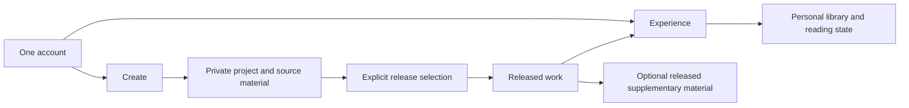

# Create and Experience: the Rawan product bridge

Implementation update (12 October 2026): originally Horizon 2 backend scopes N01–N26 are now implemented in bounded form; see the [current backend guide](backend-horizon-2.md) and [validation ledger](backend-horizon-2-implementation.md). These backend capabilities are available to a future frontend. Horizon 3 remains deferred and no frontend changes accompany this implementation. The study below preserves its original research baseline; its old capability gaps/horizon labels must be read alongside the current register, not as current implementation status.

## Mandatory product horizons

Use the [feature register](product-horizons.md) for the six required support/gap/implication/ADR fields. The first proposed publishing/reader milestone is H2, not current functionality.

| Horizon                 | Major recommendations and register IDs                                                                                                                                            |
| ----------------------- | --------------------------------------------------------------------------------------------------------------------------------------------------------------------------------- |
| H1 — Current Rawan      | Account preferences and private development/organization: C01–C11; existing dev/test AI only: C12                                                                                 |
| H2 — Near future        | Stable works/releases (N01/N02), basic reader (N03), library/progress (N04/N05), public credits/series (N11–N13), selected supplements (N15) and scoped graphic formats (N20–N23) |
| H3 — Long-term platform | Unified ecosystem and cross-work universes (L01/L02), community/recommendations/commerce/distribution (L03–L07), native art and collaboration (L08–L10)                           |

Repository investigation: 12 October 2026. This document proposes a coherent backend direction; it does not introduce working publication, reader, comics or library APIs. Read it alongside the [current capability audit](product-scope-and-backend-capabilities.md).

See [dedicated reader experience research](reader-experience-research.md) for prose-reading controls, responsive behavior and release-aware reading-state requirements.

## One ecosystem, two experiences

**Create** is the private environment for developing literary and illustrated works. **Experience** is the environment for encountering, reading, collecting and exploring released works. The same person can use both. They share account identity, the identity of a work, creator attribution and intentionally exposed material; they do not share unrestricted access to drafts.

The bridge is **a work with an intentional publication or sharing boundary**. A dashboard choice alone cannot create that boundary. A creator's project is an editing container, while a reader needs a stable, readable release with clear access rules.

Account preferences, private creative sources and private Work identities/source links now exist. Release selection, released works, reader libraries and reading state in this diagram remain proposed future capabilities.

## What the repository establishes

| Existing evidence                                                 | Implication for the bridge                                                                                |
| ----------------------------------------------------------------- | --------------------------------------------------------------------------------------------------------- |
| `User` with `Author` profile and `UserOnboarding` preferences     | Reuse one identity across experiences. Current author/reader choices are preferences, not security grants |
| `Project` owns books, notes, entities, timelines, plots and media | Preserve this private creative container; do not treat every project as a published work                  |
| `Book → Chapter → Scene`, with scene text                         | A foundation for prose creation, but no work type, edition, release or public reading contract            |
| Characters, places, factions, artifacts and relationships         | Potential source material for an optional released exploration experience                                 |
| Private media and project search                                  | Useful in Create; neither is a public asset service or discovery catalogue                                |
| Owner-scoped reads and writes                                     | Current resources cannot be offered to readers by removing authentication or ownership checks             |
| Author/reader dashboard selection                                 | Navigation scaffolding exists; reader-facing content and state do not                                     |

Private `Work` and `WorkSource` are implemented. There is no `Publication`, `Edition`, `Series`, library entry, bookmark, annotation, comic page/panel or map model. `Author` has stored profile fields, but there is no public author-profile API. Existing entity links remain project-scoped; explicit private Work sources can span owned projects without changing those rules.

## Proposed responsibilities, not an immediate schema

| Concept          | Responsibility                                                                        | Current status                                                     |
| ---------------- | ------------------------------------------------------------------------------------- | ------------------------------------------------------------------ |
| Account          | Identity, preferences and access decisions                                            | Exists; future reader access rules still needed                    |
| Creative project | Private drafts, research, planning and source organization                            | Exists                                                             |
| Work             | Stable identity of a literary or illustrated creation and its attribution             | Proposed                                                           |
| Release          | A selected, versioned readable representation of a work with visibility/access policy | Proposed                                                           |
| Edition          | An identified variation of a work when the product needs edition semantics            | Future scope decision; not necessarily needed in the first release |
| Series           | Ordered association of works, with its own metadata where appropriate                 | Proposed; not implied by book positions within a project           |
| Supplement       | Explicitly released lore, timeline, relationship or media content attached to a work  | Proposed                                                           |
| Library entry    | A reader's saved relationship to a work                                               | Proposed; saving is not ownership or permission to read            |
| Reading state    | Reader progress and later bookmarks/highlights/annotations                            | Proposed                                                           |

“Book”, “comic”, “short story”, “essay” and “nonfiction” should describe supported work forms or classifications when implemented. A series groups works rather than necessarily being a competing content format. A world can connect to multiple works; a work need not have a world. These are conceptual distinctions, not enum values to add now.

Do not rename today's `Book` to `Work` or change its API meaning merely to accommodate the vision. A future work can retain a relationship to its private source, while its readable release has a distinct representation and access contract. Multiple manuscripts within one project do not automatically form a series, and one project does not automatically equal one work.

## The publication boundary

The proposed release workflow is:

1. Choose the work's source content and reader-facing metadata.
2. Choose any supplementary material to expose; default to none.
3. Validate content order, supported format, required metadata, asset availability and permissions.
4. Preview the exact reader representation.
5. Publish or share an identified release through an explicit access policy.
6. Route discovery, reading and exploration through that release rather than private source endpoints.

Draft edits should not silently alter an existing release. A later update should produce an explicitly published version or follow another documented update policy. Define withdrawal behavior, accessible previous versions and saved reader state before implementing releases. A simple first milestone can support public/free releases only; unlisted sharing, restricted readers, payments and edition management remain separate scope decisions.

Do not store authentication data, internal AI prompts, private tags, planning notes or storage paths in a release representation. Do not make uploaded reference media public automatically. Only selected assets with an intentional delivery policy belong in the reader representation.

Today's project deletion cascades through private source records. Future publication persistence must explicitly decide what happens to a release when its source project, author profile or account is deleted. Copying foreign-key cascade behavior without that decision could unintentionally remove published works or leave broken releases.

## Reading and exploration are connected but optional

Reading should work without requiring a reader to learn the creator's project structure. A prose release needs ordered readable content; comics need supported page/panel structure and reading order. File uploads and scene strings alone do not constitute a comics system.

Exploration is an optional companion to a released work. A creator may expose a character profile, timeline or selected relationship graph, while keeping secret identities, future plot points and research private. Maps require backend structures that do not exist today. Existing places are text entities, not map pins.

Exposure must cover linked data as well as the selected item. If a released character links to a private faction, the reader response must omit or safely represent that reference without granting access to its source record. A graph cannot reveal private node names merely because an edge was selected. Released relationships and timelines need validated reader-safe targets.

Spoiler handling is a further product decision. An initial scope can avoid automatic progress-based reveals and let creators select safe supplementary material. Progress-based unlocks would require a release-aware rule system and are not an existing capability.

## Coherence across the two experiences

| Shared element         | Create view                           | Experience view                                |
| ---------------------- | ------------------------------------- | ---------------------------------------------- |
| Account                | Create and manage owned material      | Read, save and explore permitted releases      |
| Work identity          | Source and release management         | Work detail, attribution and available release |
| Creator identity       | Private account/profile management    | Selected public attribution/profile fields     |
| Content                | Editable manuscripts and planning     | Readable published representation              |
| Supplementary material | Full private organization             | Selected reader-safe material                  |
| Series                 | Manage work ordering when implemented | Navigate published, accessible entries         |

Use Create and Experience as product navigation concepts without replacing existing route paths in this investigation. Current author/reader/both/explore preferences can guide the initial destination. They must not permanently lock someone into one experience or authorize access to someone else's source content. Future permission checks should answer whether this account may edit a project or read a release, not merely whether it selected Author or Reader.

A work detail page can become the shared destination: readers see released content and allowed actions; an owner can also enter Create to edit its source. That requires future APIs. Private drafts should not appear as catalogue entries, and a library entry should not masquerade as a writable project.

## A bounded first bridge milestone

The first proposed milestone is **one supported prose work released for reading, then saved and resumed by another account**. This closes a real creator-to-reader loop without requiring comics, payments, community or an entire publishing suite.

Suggested implementation sequence, subject to agreed product scope:

1. Define stable work identity, creator attribution, ordered prose release content and public/free visibility. Resolve source deletion and release update policies.
2. Add explicit release creation/preview/publish/withdraw behavior, reader-safe response types and content delivery. Keep existing owner APIs unchanged.
3. Add a released-work detail/read contract. Only publicly eligible released works may enter discovery queries; publication does not automatically expose the whole project.
4. Add current-user library entries and release-aware progress. Initially a bounded catalogue query can support discovery; advanced recommendations are unnecessary for this loop.
5. Add selected supplementary lore only after the basic release and access rules are verified. Expand series, other formats and reader annotations through separate contracts.

The proposed milestone should pass these acceptance cases:

- Account B cannot read account A's drafts or private notes.
- Publishing exposes only the chosen readable content and approved metadata/assets.
- Editing A's source does not change the released content until an explicit update.
- B can save the work and resume reading; account C cannot read B's personal reading state.
- Withdrawal follows the agreed read/discovery policy and leaves library entries in a defined, non-broken state.
- Hidden linked lore remains inaccessible through direct IDs, graph links, search and media URLs.
- Updating a release has a defined progress mapping/reset policy; highlights added later must have version-aware anchors.

These are future implementation acceptance criteria, not tests of delivered functionality.

## Scope boundaries

**Already supported:** accounts, preferences and private creative organization. **Next frontend using existing APIs:** private manuscript editing, notes, planning, entity organization, media and project search. **Future backend bridge:** work identity, publication/release access, reader delivery, libraries and progress. **Long-term possibilities:** comics, advanced series/universe exploration, annotations, editorial collaboration, communities and commerce.

No migrations, new routes, permissions or UI changes are made by this investigation. Its purpose is to make the first publishing/reader backend proposal concrete while preserving the current contract.

## Repository evidence

- [Database schema](../packages/database/prisma/schema.prisma)
- [Manuscript controller](../apps/api/src/manuscript/manuscript.controller.ts) and [ownership-scoped service](../apps/api/src/manuscript/manuscript.service.ts)
- [Reviewed API contract](contracts/backend-v1.openapi.json) and [route inventory](api-route-inventory.md)
- [Account experience](account-experience.md) and [dashboard routing](../apps/website/src/lib/experience.ts)
- [Media backend](media-domain.md) and [product capability audit](product-scope-and-backend-capabilities.md)
