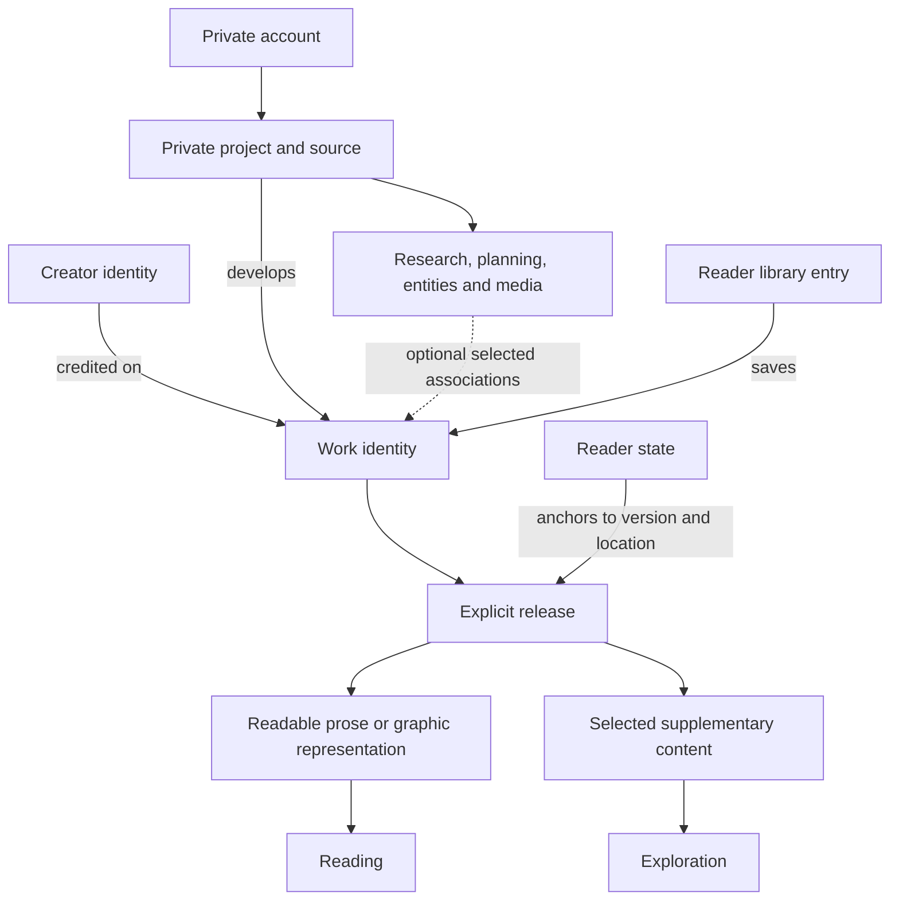

# The work at the center of Rawan

Implementation update (12 October 2026): originally Horizon 2 backend scopes N01–N26 are now implemented in bounded form; see the [current backend guide](backend-horizon-2.md) and [validation ledger](backend-horizon-2-implementation.md). These backend capabilities are available to a future frontend. Horizon 3 remains deferred and no frontend changes accompany this implementation. The study below preserves its original research baseline; its old capability gaps/horizon labels must be read alongside the current register, not as current implementation status.

## Mandatory product horizons

The [feature register](product-horizons.md) supplies all six required fields. Work-centered organization is a strategic principle, not an implemented Work record or reader bridge.

| Horizon                 | Major recommendations and register IDs                                                                                                                                                         |
| ----------------------- | ---------------------------------------------------------------------------------------------------------------------------------------------------------------------------------------------- |
| H1 — Current Rawan      | Existing private project integration (C02–C09), account preferences (C01), consistent work-context language/local controls (C10)                                                               |
| H2 — Near future        | Stable Work/source/release/credits (N01/N02/N11), basic reading/library/state (N03–N08), metadata/series/supplements (N10/N13/N15), supported new content formats (N20–N23) and editions (N26) |
| H3 — Long-term platform | Work-centered ecosystem (L01), cross-work/shared universe reuse (L02), community/recommendations/distribution (L03–L07), collaborative creation/native art (L08–L10)                           |

Research date: 12 October 2026. This document establishes the connecting product principle for the earlier investigations. It is a domain and UX recommendation, not an implemented Work model, new API or route change.

## Principle

**Rawan is a platform around the creation, organization, exploration, and experience of books and literary works.**

The work connects creators and readers throughout the ecosystem. Writing, research, world organization, media, publishing, reading and libraries each contribute to its development or experience. Architecture, terminology and navigation should express those relationships, with creation and reading treated as primary experiences and supporting tools adapted to the work's needs.

**The work is the product's organizing center, not the owner of every database record.** Private projects, shared supporting material, releases, creator credits and personal reader state still need precise responsibilities, permissions and lifecycles.

A work can exist conceptually while it is being drafted, before publication. Conversely, a research-only or world-development project may never produce a publishable work. Do not require those projects to invent a Book or future Work record to remain useful.

## Research and domain terminology

Schema.org uses CreativeWork as a broad identity with creator, content, media and related-work relationships, and describes CreativeWorkSeries as a grouping of related works. This supports a work-centered vocabulary without treating every association as a chapter or scene. [CreativeWork](https://schema.org/CreativeWork), [CreativeWorkSeries](https://schema.org/CreativeWorkSeries).

W3C's EPUB overview separates publication content resources, metadata, reading order and navigation. That informs the distinction between a creative identity and a reader-delivery representation; it does not require the private editor to become an EPUB package. [EPUB overview](https://www.w3.org/TR/epub-overview-33/).

The recommended Rawan vocabulary below is a design inference. No external vocabulary alone determines Rawan's schema or access model.

| Term                         | Recommended responsibility                                                              | Existing status                                                                    |
| ---------------------------- | --------------------------------------------------------------------------------------- | ---------------------------------------------------------------------------------- |
| Account                      | Private identity and authorization                                                      | Exists                                                                             |
| Creator identity / credit    | Public persona and attribution role on a work                                           | Current Author is an ownership profile; independent public credits are future work |
| Project                      | Private development container for manuscripts and supporting material                   | Exists                                                                             |
| Manuscript / source content  | Editable prose or future graphic content                                                | Current Book/Chapter/Scene stores private text; graphic structure is absent        |
| Work                         | Stable creative identity across its source, presentation and supported related material | Private Work/source API exists; public release/reader bridge remains future        |
| Supporting material          | Private research, planning, entities and media relevant to development                  | Existing project resources, with bounded associations                              |
| World / universe             | Optional organized fictional context, potentially shared by works                       | Project entities exist; independent/cross-work universe identity is absent         |
| Edition                      | Bibliographic or format/language distinction when needed                                | Absent                                                                             |
| Release                      | Explicitly available content version with visibility and delivery policy                | Absent                                                                             |
| Supplement                   | Selected reader-safe lore, media or other material associated with a release            | Absent as a publication contract                                                   |
| Library entry / reader state | A person's saved relationship and locations/annotations in readable releases            | Absent                                                                             |

Use “Book”, “Comic” or “Story” as supported form-specific language in the appropriate experience. Work is the broader architectural concept; it need not replace every reader-facing label. Keep today's API `Book` meaning unchanged.

## Connected conceptual model

This is a proposed relationship diagram, not a representation of implemented tables. Account/project ownership exists today; the work/release/reader bridge remains future backend work.

A private project can contain multiple manuscripts. Do not assume one project equals one work or that every manuscript becomes a public work automatically. Source associations and grouping need explicit semantics when the Work contract is introduced. An anthology or series also needs deliberate constituent relationships rather than inference from project positions.

Supporting entities can serve more than one manuscript within today's project. Future reuse across works/projects needs explicit association and ownership design, not duplicated character records or unvalidated cross-project IDs. A world may connect to several works, while a work may have no fictional world at all.

## How the tools connect

| System                         | Work-centered behavior                                                     | Boundary                                                                       |
| ------------------------------ | -------------------------------------------------------------------------- | ------------------------------------------------------------------------------ |
| Writing / comic creation       | Opens the selected work's source or current private manuscript context     | Prose and graphics use their actual supported content structures               |
| Research / notes               | Supports development with relevant project/source context                  | Research need not all belong to one final work or become public                |
| Characters / places / planning | Links supporting material to the narrative where supported                 | Optional tools; no required worldbuilding checklist                            |
| Media                          | Distinguishes private references, source artwork and chosen release assets | Reference upload is not automatically a cover, comic page or public supplement |
| Publication / sharing          | Selects readable content and approved metadata/assets for a work           | A release never exposes the entire private project by default                  |
| Discovery / creator pages      | Leads to the same eligible work identity                                   | No private drafts or account/persona links leaked through attribution          |
| Library                        | Saves a relationship to the work                                           | Saving does not copy source material or grant editing/reading rights           |
| Reading / progress             | Reads a permitted release and retains a content-based location             | Progress is per reader and version-aware, not a shared Work field              |
| Highlights / annotations       | Anchors personal observations to released content                          | Personal by default; no implicit public discussion system                      |
| Exploration                    | Opens selected supplementary material in work/release context              | Hidden lore and references stay private, including linked targets              |

Maps, comic pages/panels, public series/universes and supplementary reader projections are not supported merely because they appear in this table. The [capability audit](product-scope-and-backend-capabilities.md) remains the implementation boundary.

## Product continuity, not one universal screen

Create, My Library and Discover remain task-based entry points into the same ecosystem. They should not create separate identities for the same work. A reader can arrive from search, a creator page, a series or a collection and reach the same work detail, then read an available release. Its owner can have an authorized path back to source/release management.

Work context should be clear through title, identity and meaningful return navigation. Reading typography and author tool navigation can differ substantially while the identity remains consistent. Do not solve continuity by showing every writing/worldbuilding control in the reader or every public catalogue feature inside the editor.

Relevant contextual connections can reduce unnecessary switching: a creator follows a scene's linked character, returns to writing, and later previews selected reader material; a reader follows released lore and returns to the same text location. Each path must preserve authorization and context. These are future UX behaviors where their supporting links/releases do not exist today.

“Work center” should mean a coherent relationship and task context, not a dashboard with a tile for every imaginable feature. Expose only the tools and reader material available for the selected content, progressively and calmly.

## Architectural guardrails

1. **Stable identity:** future work IDs connect source associations, credits, catalogue entries and library relationships. Slugs, titles, filenames, ISBNs and changing account display names do not replace identity.
2. **Private source boundary:** retain existing project ownership and API semantics. A future Work record or publication flag must not make drafts, notes, AI context or all project entities publicly readable.
3. **Separate release responsibility:** record what content/version is available and under what policy. Draft edits do not silently mutate published reading content. Editions and release updates need distinct definitions when supported.
4. **Explicit associations:** give relationships precise meanings—credit, source, supplement, series membership or related work. Do not treat every link as interchangeable or add a generic relationship table that bypasses validation.
5. **Personal state:** library membership, status, progress and annotations belong to an account's relationship to the work/release. Public metadata caching must exclude them.
6. **Independent lifecycles:** removing a library entry is not deleting a work; withdrawing a release is not deleting its private source; deleting an avatar is not deleting a creator's catalogue. Current cascading deletes require explicit review before releases depend on source assets.
7. **Optional worldbuilding:** tools support the work where useful, without mandating a fictional universe, map or entity set. Real-world research and prose-only workflows remain valid.
8. **Format-specific structures:** share identity, ownership and publication conventions while preserving the actual data and navigation needs of prose, nonfiction and graphics.

Avoid a single Work object containing every draft, chapter, entity, media asset, all contributor data and every reader annotation. The work is a connecting identity across domain responsibilities, not justification for a large all-in-one response, table or service.

## Gap and evolutionary path

Today's Project is the integration point for private creative resources; Book is a private manuscript container. There is no persistent work identity bridging those resources to publication and reading. Do not relabel Project as Work to conceal that gap or reparent all existing entities prematurely.

The proposed first bridge is an additive stable work/source association, public attribution and an explicitly readable prose release. It should support one creator developing a work and another account reading, saving and resuming it. Build each identity/access boundary through reviewed APIs and forward migrations; no such changes are made by this study.

Later selected supplements, series/universe relationships, graphical content and richer reader state can connect through that same identity/release boundary. A research-only project remains useful without entering publishing. Domain expansion should follow concrete milestones rather than implementing the entire diagram at once.

Before implementation, agree on what establishes a work, which source objects it can associate with initially, whether multiple sources are in first scope, what a release includes, who can credit a persona, and how removal/withdrawal affects readers. These decisions matter more than creating a Work table with a speculative field list.

Future acceptance scenarios should follow one work across Create → release preview → Discover → My Library → reading → selected lore → restored reading position. Include private-note exclusion, two pen names, a shared supporting character, rereading, release updates and withdrawal. These scenarios must demonstrate coherent identity and access, not merely successful navigation between screens.

## Related investigations

- [Work identity and metadata gaps](book-and-work-identity-gap-analysis.md) and [publication bridge](create-and-experience-bridge.md)
- [Information architecture alternatives](expanded-information-architecture-study.md)
- [Creator identities](creator-identity-research.md), [optional worldbuilding](optional-worldbuilding-and-workspaces.md) and [comic implications](comics-backend-implications.md)
- [Reader experience](reader-experience-research.md), [library](library-system-research.md) and [discovery](discovery-experience-research.md)
- [Current schema](../packages/database/prisma/schema.prisma) and [reviewed API contract](contracts/backend-v1.openapi.json)
